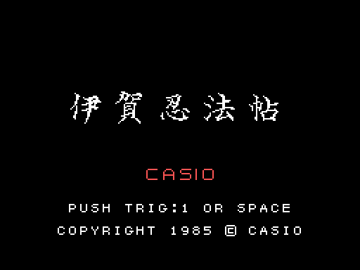
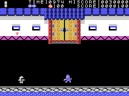
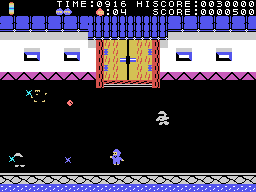
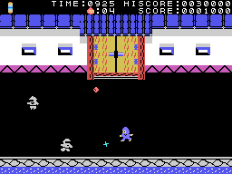

# The game

*Iga Ninpōchō* is a ninja breaking into a castle: in front of the wall he knocks down whoever gets in his way
until the gate opens; inside, he goes through three floors full of *kakejiku* (hanging scrolls) looking for the
secret scroll, and with the scroll he leaves through each hall's door; the last one is the tower. The five stages
are in [The stages](THE-STAGES.html).

Every GIF on this site is the ROM **running in openMSX** (a Japanese MSX1 with C-BIOS, at 60 frames per
second): on every frame the VRAM and the VDP registers are logged, and `tools/vdp.py` paints them.

## The intro and the title

At power-on, four CASIO logos come in from the left, the right, the top and the bottom and meet in the middle,
with their tune (`presentacion`, 0x9D22). Then the title: 伊賀忍法帖 in big letters, CASIO, PUSH TRIG:1 OR SPACE
and the copyright. After 240 frames without touching anything a **demo** starts on a random stage from 1 to 4,
with the stick and the jump button set at random every 24 frames (`interrupcion_quieto`, 0x8FEE).

## The controls

| | joystick | keyboard |
|---|---|---|
| move | joystick 1 | the cursor keys |
| throw the star | button A | GRAPH |
| jump | button B | the space bar |
| start | button A | the space bar |

On stage 1 the ninja walks in eight directions; inside the castle, left and right along each floor, and **up and
down only on the stairs**. Down away from a staircase makes him **crouch**: the ones that run across pass over
him (`tipo1_toca`, 0x852F). The **star** (*shuriken*) flies the way he faces, 3 dots per frame, and there is no
other until it is gone (`tira`, 0x9296). The **jump** is on the spot, or sideways if the stick is held; jumping
sideways into the ninja who walk the floors knocks them down (`tipo3_toca`, 0x876C).

## TIME and the lives

**TIME** starts at **1000** on every stage and goes down one every 7 frames (every 6, 5... down to 2 on later
rounds, `tiempo`, 0x8D85); below 100 a warning sounds, and at zero **OVER** comes up and the life is lost. The game
starts with **three spare lives**, drawn at the top (up to five). One is lost when the ninja is touched, when he
falls into a pit or when TIME runs out; the stage starts again (`tocado`, 0x8B7B). With no spare lives, **GAME
OVER**. There is an extra life the first time the score passes **3,000** and another every **10,000** (up to
nine, `puntos`, 0x90AE).

## The points

- An enemy knocked down, **5**; on stage 1, or the one that shoots arrows, **10** (`tipo3_puntos`, 0x87F0).
- The arrow one, when it starts jumping at the ninja and falls into a pit, **100** (`tipo3_estado4`, 0x8955).
- The prize left behind some kakejiku, and the object on the little shrines, **100** each, if hit jumping.
- The **secret scroll**, **500** (`salto_rollo`, 0xB633).
- At the end of a stage, each unit of TIME left is worth as many points as enemies knocked down on the stage (at
  least one; on stage 1, one) (`fin_cuenta`, 0x8CE6).
