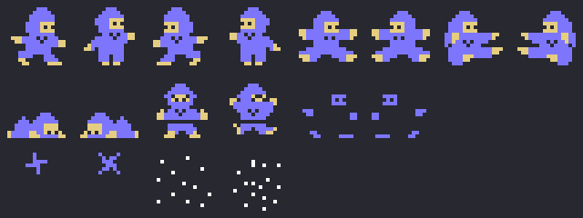
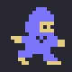
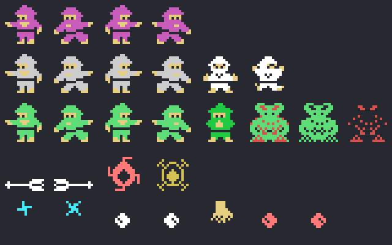
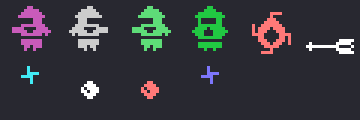

# The sprites

Everything on this page is **put together from the ROM tables** with `tools/hojas.py`: the drawings loaded the way
the game loads them and every figure built with the drawings and colours its own code gives it. None of these images
is a screenshot.

**Checked against openMSX** on the three recordings of this site:

- the sprite drawing table built here (VRAM 0x3800-0x3FFF) is **identical** to the game's on 34,851 frames (3 more
  catch the copy halfway);
- the ninja's two sprites (0xE100) match on **19,464 frames, 0 different** (18,398 with both sprites and 1,066 with
  only one, with the object); 368 more are not placed yet when a stage starts, and on 84 frames of stage 4 with the
  object the second sprite comes back at his height with the drawing of the jump before;
- the drawing and the colour of the others (0xE300, 16 bytes each) match what their routine gives them on 18,601
  frames; 84 more have just come out and 92 were drawn just before changing state, side or wait; **5 unexplained**.

## The ninja

Two sprites at the same height: the drawing in light blue (colour 5) and the drawing + 4 on top in light yellow (11)
(`fase` 0x816F, `prota_dibujo_dos` 0x96A5). Top row: walking right (0x28 and 0x30) and left (0x00 and 0x08), one
or the other every 8 frames (`prota_dibujo`, 0x966E); jumping on the spot (0x40 right, 0x18 left) and sideways
(0x38 and 0x10) (`salto_dibujo`, 0x9A00). Second row: crouching (0x48 and 0x20, `agacha` 0xA8F0), hit (0x88 and
0x90, `tocado_cuadro` 0x8BA6) and, from stage 4 with the object of the little shrine, with a **single sprite**: the
drawing + 4 in light blue, which leaves little more than his hands, feet and eyes. Below, the star (0xA4 and 0xA8 in light blue,
`tira_normal` 0x92DB) and the big one of stage 2 with the object (0xB0 and 0xB4 in white, 0x92CC):

Walking right and left and hit, at the game's pace:

## The others

Each one is a **single sprite**, 16 bytes at 0xE300 (Y, X, drawing and colour first, which `sprites_tabla`, 0x9CD1,
copies to the sprite table every frame). The ninja on the floors (types 3, 5 and 8, `tipo3_dibujo` 0x8831) take
0x50, + 0x10 when they go right, + 8 every 8 frames for the step; and on odd values of their wait (+8) the drawing
+ 4 in light yellow. Their wait changes every frame or two, so the game shows **the body and the details in turns**,
and the eye sees both: that is how a single sprite gets two colours. Type 3 is magenta (13), the ninja of stage 1
(type 5) grey (14) and type 8 light green (3); knocked down, they fall with the drawing of the hit ninja (0x88, in
white, 0x8822). Type 8, in some columns, blinks for 64 frames (0x70 in green and 0x74 in light yellow,
`tipo3_estado3` 0x8927) and then jumps at the ninja with the drawings 0xB8 (light green) and 0xBC (dark red) in
turns (`tipo3_estado4_dibujo`, 0x899C); on the right, each one alone:

Fourth row, the ones that cross the screen: type 1, an **arrow** (0x78 going left, 0x7C going right, white,
`sale_lado` 0x84F6), and type 2 (0x80 and 0x84 every 4 frames, light red and dark yellow every 2,
`tipo2_dibujo` 0x85A3). Last row, what they throw (`tipo3_tira`, 0x8694): the stars of types 3 and 5 (type 4: 0xA4
and 0xA8, cyan) and the balls of type 8 (type 7: 0x9C and 0xA0, white, `tipo4_dibujo` 0x89F6); and what falls on
stage 1 (type 6: 0x98 in light yellow, then 0x9C and 0xA0 in light red).

All of them frame by frame, at the game's pace (here the ninja show their two drawings on alternate frames):

