# The stages

Five stages: the castle wall, three halls inside and the tower. After the fifth it goes back to the first on one
more **round** (up to nine), with TIME going down faster (`fase_siguiente`, 0x8D38).

The maps on this page are the ones the game builds in RAM (0xE700, `mapa_fase`, 0x9A4D), painted whole with their
tiles (`tools/mapas.py`, from the openMSX recording). The screen shows 22 rows of 32 tiles and scrolls over the map
(`mapa_pantalla`, 0xBFA1).

**Note: forced recording.** The GIFs of the castle gate, the entrance, the kakejiku and the exit come from
`tools/guiones/fases.tcl`: the Tcl pilot that plays never manages to knock down ten enemies with one life, so the
count is set to 9 and it knocks down the tenth itself; and inside the castle the script takes the ninja (his place
in the map, the screen and the sprite) under the last kakejiku, to the scroll and to the exit door. What happens
next is the game's doing.

## Stage 1: the wall

In front of the castle, with no floors: the ninja walks in eight directions between the wall and the moat. Ninja
come in from the sides walking along a row and throw stars at him, and now and then things fall from above,
veering towards him (`tipo6`, 0x8A5C). The count of the ones knocked down is at the top, next to the lives: with
**ten** the gate opens (0xE1B2, `tipo3_cae`, 0x87BC), the ninja walks up to it and goes in (`fase_fin`, 0x8C49).

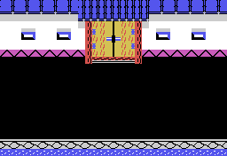

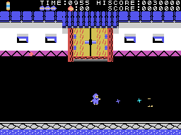

## Stages 2 to 4: inside the castle

Three floors joined by staircases, on a map 96 tiles wide; the screen scrolls sideways when the ninja walks in
the middle (`pantalla_corre`, 0x9208). The ninja comes in through a door that opens and closes behind him
(`puerta_entra`, 0x916A). The three halls are built the same way: three rows of ceiling, the floors and the
ground, and on top **pieces** set at the addresses of a list per stage (`mapa_piezas`, 0x9B05): round windows,
little shrines, kakejiku, doors and staircases, and from stage 4 walls that cannot be crossed.

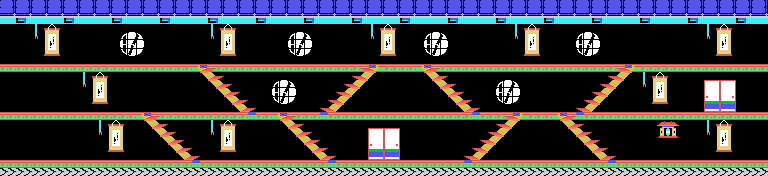

### The kakejiku and the scroll

Each **kakejiku** (the hanging scroll) has a cord on its left. The ninja jumps under it, pulls the cord and the
scroll rolls up (`kakejiku`, 0x9FD5). Behind it is **the secret scroll, only in the last one to be opened**: stage
2 has 10 kakejiku, stage 3 has 18, stage 4 has 20 and stage 5 has 9, and the scroll comes out in the tenth, the
eighteenth, the twentieth or the ninth (0x9FF4). In the others, at random: a skeleton or a white flame, and the
floor opens a **spiked pit** to one side, as wide as the stage number (`kakejiku_suelo`, 0xA040); or a 100-point
prize. The scroll is taken by jumping under it (500 points), and then the hall's **exit door** opens when the
ninja reaches it (`puerta_llega`, 0xB662).

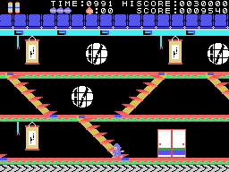

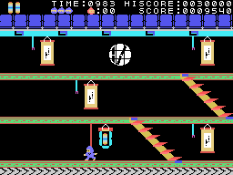

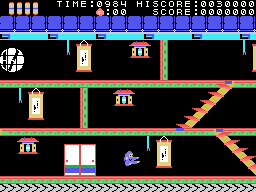

### The little shrines

In the middle of each little shrine there is an object taken by jumping (100 points). For about 13 seconds
(3 x 256 frames, with a sound that never stops) it does something that depends on the stage: on stage 2 the star
is big, goes through and also knocks away the ones that run across; on stage 3 the ninja on the floors stand
still and do not throw; from stage 4 on, nothing happens to the ninja if he is touched (`tocado`, 0x8B81), and he
is drawn with a single sprite.

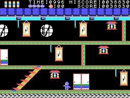

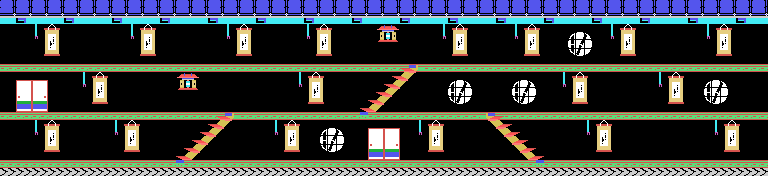

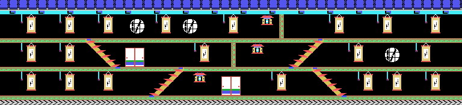

## Stage 5: the tower

The castle tower: a map 32 tiles wide and 66 rows tall that scrolls **up and down** when the ninja climbs or
goes down the stairs (0xE19A, `escalera_sube_8`, 0x9468). He comes in at the bottom and the exit door is at the
top, under the roof; the ten top rows (the roof) come compressed from the ROM (0xB764) and the rest is filled with
a floor every six rows.

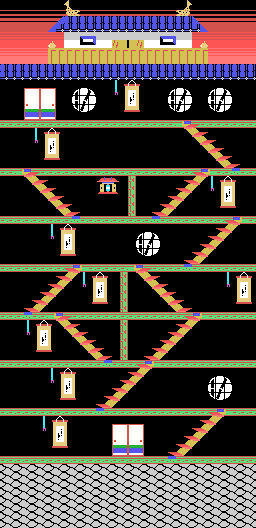

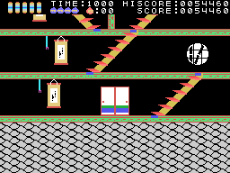

## The enemies

They come out in turns when a count reaches zero, faster on higher stages (`salen`, 0x82A8), and each one does
its own thing by its type (`otro`, 0x844F):

| type | what it does |
|---|---|
| 1 | crosses the screen from side to side, 3 dots per frame, at the height of a floor or of the ninja |
| 2 | crosses one dot at a time, changing colour |
| 3 | a ninja that walks along a floor, turns back at walls and pits and throws stars |
| 8 | from stage 3, instead of type 3: shoots arrows, and in some columns starts blinking and then jumps at the ninja |
| 5 | the ninja of stage 1, who come in from the sides in a row |
| 6 | what falls from above on stage 1, veering towards the ninja |
| 4 and 7 | the stars and the arrows the others throw |

Types 3, 5 and 8 are knocked down with the star or by jumping sideways into them; the others can only be dodged
(on stage 2 with the shrine's object, the star also takes types 1 and 2 away).
