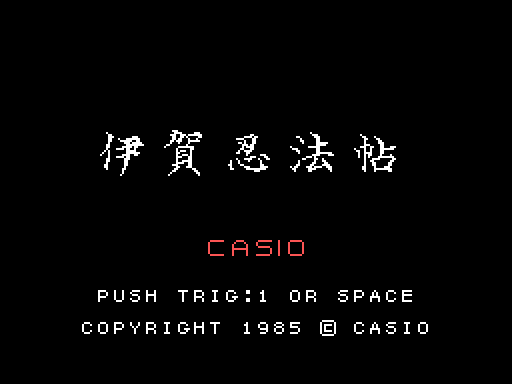
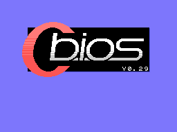
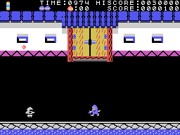
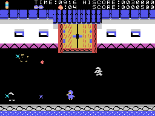
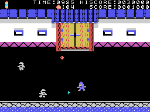

# La partida

*Iga Ninpōchō* es un ninja que entra en un castillo: delante de la muralla tumba a los que le salen al paso
hasta que se abre la puerta; dentro, recorre tres pisos llenos de *kakejiku* (los cuadros colgados) buscando el
rollo secreto, y con el rollo sale por la puerta de cada sala; la última es la torre. Las cinco fases están en
[Las fases](LAS-FASES.html).

Todos los GIF de esta web son la ROM **funcionando en openMSX** (un MSX1 japonés con C-BIOS, a 60 cuadros por
segundo): en cada cuadro se apuntan la VRAM y los registros del VDP, y `tools/vdp.py` los pinta.

## La presentación y el título

Al encender, cuatro CASIO entran por la izquierda, la derecha, arriba y abajo y se juntan en el centro, con su
música (`presentacion`, 0x9D22). Después, el título: 伊賀忍法帖 en letras grandes, CASIO, PUSH TRIG:1 OR SPACE y
el copyright. A los 240 cuadros sin tocar nada empieza una **demostración** en una fase al azar de la 1 a la 4,
con la palanca y el botón de saltar al azar cada 24 cuadros (`interrupcion_quieto`, 0x8FEE).

## Los mandos

| | mando | teclado |
|---|---|---|
| moverse | el mando 1 | los cursores |
| tirar la estrella | el botón A | GRAPH |
| saltar | el botón B | la barra espaciadora |
| empezar | el botón A | la barra espaciadora |

En la fase 1 el ninja anda en ocho direcciones; dentro del castillo, a izquierda y derecha por cada piso, y
**arriba y abajo solo por las escaleras**. Abajo fuera de una escalera, **se agacha**: los que cruzan corriendo le
pasan por encima (`tipo1_toca`, 0x852F). La **estrella** (*shuriken*) sale hacia donde mira, 3 puntos por cuadro,
y hasta que no se pierde no sale otra (`tira`, 0x9296). El **salto** es en el sitio o hacia un lado si se lleva la
palanca; saltando de lado se tumba a los ninja que andan por los pisos (`tipo3_toca`, 0x876C).

## TIME y las vidas

**TIME** empieza en **1000** en cada fase y baja uno cada 7 cuadros (cada 6, 5... hasta 2 en las vueltas
siguientes, `tiempo`, 0x8D85); por debajo de 100 suena un aviso, y a cero sale **OVER** y la vida se pierde. La
partida empieza con **tres vidas de reserva**, dibujadas arriba (hasta cinco). Se pierde una cuando tocan al ninja,
cuando cae en un foso o cuando se acaba TIME; la fase vuelve a empezar (`tocado`, 0x8B7B). Sin vidas de reserva,
**GAME OVER**. Hay una vida más la primera vez que los puntos pasan de **3.000** y otra cada **10.000** (hasta
nueve, `puntos`, 0x90AE).

## Los puntos

- Un enemigo tumbado, **5**; en la fase 1 o el tipo 8, el que tira bolas, **10** (`tipo3_puntos`, 0x87F0).
- El tipo 8, cuando se pone a saltar hacia el ninja y cae a un foso, **100** (`tipo3_estado4`, 0x8955).
- El premio que queda detrás de algunos kakejiku, y el objeto de los altarcitos, **100** cada uno, si se les da
  saltando.
- El **rollo secreto**, **500** (`salto_rollo`, 0xB633).
- Al acabar la fase, cada unidad de TIME que queda vale tantos puntos como enemigos tumbados en la fase (al menos
  uno; en la fase 1, uno) (`fin_cuenta`, 0x8CE6).
