# Las fases

Cinco fases: la muralla del castillo, tres salas por dentro y la torre. Tras la quinta se vuelve a la primera en
una **vuelta** más (hasta nueve), con TIME bajando más deprisa (`fase_siguiente`, 0x8D38).

Los mapas de esta página son los que el juego monta en la RAM (0xE700, `mapa_fase`, 0x9A4D), pintados enteros con
sus casillas (`tools/mapas.py`, desde la grabación de openMSX). La pantalla enseña 22 filas de 32 casillas y corre
por el mapa (`mapa_pantalla`, 0xBFA1).

**Ojo, grabación forzada.** Los GIF de la puerta del castillo, la entrada, el kakejiku y la salida salen de
`tools/guiones/fases.tcl`: el piloto en Tcl que juega no llega a tumbar diez enemigos con una vida, así que la
cuenta se pone en 9 y el décimo lo tumba él; y dentro del castillo el guion lleva al ninja (su sitio en el mapa,
la pantalla y el sprite) bajo el último kakejiku, al rollo y a la puerta de salida. Lo que pasa después lo hace el
juego.

## Fase 1: la muralla

Delante del castillo, sin pisos: el ninja anda en ocho direcciones entre la muralla y el foso del agua. Por los
lados salen ninja que andan en una fila y le tiran estrellas, y de vez en cuando caen cosas desde arriba que
bajan hacia donde está él (`tipo6`, 0x8A5C). La cuenta de los tumbados está arriba, junto a las vidas: con **diez**
se abre la puerta (0xE1B2, `tipo3_cae`, 0x87BC), el ninja sube hasta ella y entra (`fase_fin`, 0x8C49).

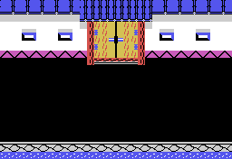

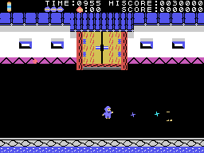

## Fases 2 a 4: dentro del castillo

Tres pisos unidos por escaleras, en un mapa de 96 casillas de ancho; la pantalla corre de lado cuando el ninja va
por el centro (`pantalla_corre`, 0x9208). El ninja entra por una puerta que se abre y se cierra detrás de él
(`puerta_entra`, 0x916A). Las tres salas se hacen igual: tres filas de techo, los pisos y el suelo, y encima
**piezas** puestas en las direcciones de una lista por fase (`mapa_piezas`, 0x9B05): ventanas redondas,
altarcitos, kakejiku, puertas y escaleras, y desde la fase 4 muros que no se cruzan.

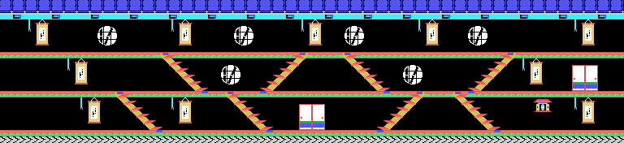

### Los kakejiku y el rollo

Cada **kakejiku** (el cuadro colgado) tiene un cordón a la izquierda. El ninja salta debajo, tira del cordón y el
cuadro se enrolla (`kakejiku`, 0x9FD5). Detrás está **el rollo secreto solo en el último que se abra**: la fase 2
tiene 10 kakejiku, la 3 tiene 18, la 4 tiene 20 y la 5 tiene 9, y el rollo sale en el décimo, el
decimoctavo, el vigésimo o el noveno (0x9FF4). En los demás, al azar: un esqueleto o una llama blanca, y en el
piso, a un lado, se abre un **foso con pinchos** tan ancho como el número de la fase (`kakejiku_suelo`, 0xA040); o un
premio de 100 puntos. El rollo se coge saltando debajo (500 puntos), y entonces la **puerta de salida** de la sala
se abre cuando el ninja llega a ella (`puerta_llega`, 0xB662).

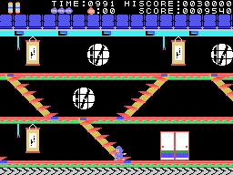

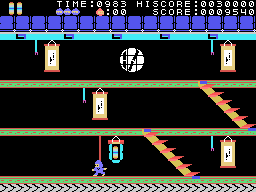

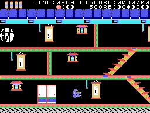

### Los altarcitos

En el centro de cada altarcito hay un objeto que se coge saltando (100 puntos). Durante unos 13 segundos
(3 x 256 cuadros, con un sonido que no para) cambia según la fase: en la 2 la estrella es grande, atraviesa y
tumba también a los que cruzan corriendo; en la 3 los ninja de los pisos se quedan quietos y no tiran; desde la 4, al ninja no le
pasa nada si lo tocan (`tocado`, 0x8B81), y se dibuja con un solo sprite.

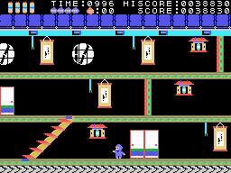

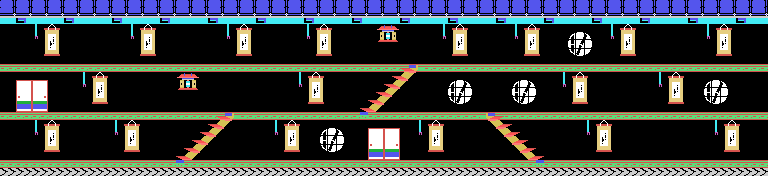

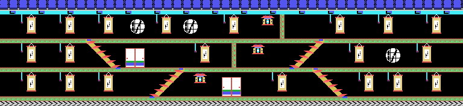

## Fase 5: la torre

La torre del castillo: un mapa de 32 casillas de ancho y 66 filas que corre **de arriba abajo** cuando el ninja
sube o baja escaleras (0xE19A, `escalera_sube_8`, 0x9468). Entra por abajo y la puerta de salida está arriba, bajo
el tejado; las diez filas de arriba (el tejado) salen comprimidas de la ROM (0xB764) y lo demás se rellena con pisos cada seis filas.

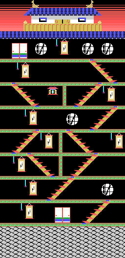

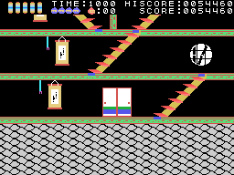

## Los enemigos

Salen por turnos cuando una cuenta llega a cero, más deprisa cuanto más alta es la fase (`salen`, 0x82A8), y
cada uno hace lo suyo según su tipo (`otro`, 0x844F):

| tipo | qué hace |
|---|---|
| 1 | una flecha: cruza la pantalla de lado a lado, 3 puntos por cuadro, a la altura de un piso o del ninja |
| 2 | cruza de punto en punto cambiando de color |
| 3 | un ninja que anda por un piso, da la vuelta en los muros y los fosos y tira estrellas |
| 8 | desde la fase 3, en lugar del 3: tira bolas, y en unas columnas se pone a parpadear y luego salta hacia el ninja |
| 5 | los ninja de la fase 1, que salen por los lados en una fila |
| 6 | lo que cae desde arriba en la fase 1, torciendo hacia el ninja |
| 4 y 7 | las estrellas y las bolas que tiran los otros |

Los tipos 3, 5 y 8 se tumban con la estrella o saltándoles de lado; los demás solo hay que esquivarlos (en la
fase 2 con el objeto del altarcito, la estrella también se lleva a los tipos 1 y 2).
