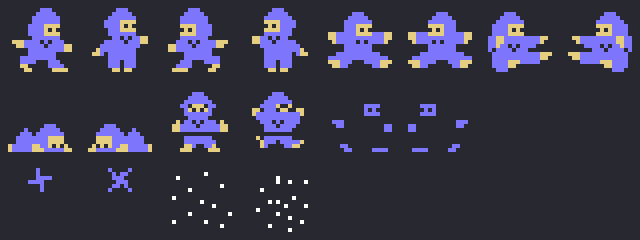
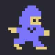
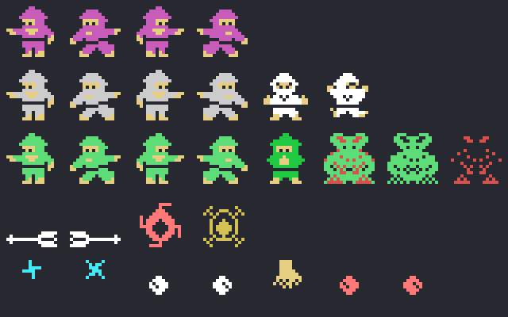
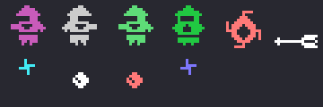

# Los sprites

Todo lo de esta página está **montado desde las tablas de la ROM** con `tools/hojas.py`: los dibujos cargados como
los carga el juego y cada figura armada con los dibujos y los colores que le da su propio código. Ninguna de estas
imágenes es una captura.

**Cotejado con openMSX** en las tres grabaciones de esta web:

- la tabla de dibujos de los sprites montada aquí (VRAM 0x3800-0x3FFF) es **idéntica** a la del juego en 34.851
  cuadros (otros 3 pillan la copia a medias);
- los dos sprites del ninja (0xE100) casan en **19.464 cuadros, 0 distintos** (18.398 con los dos sprites y 1.066
  con uno solo, con el objeto); otros 368 aún no están puestos al empezar una fase, y en 84 cuadros de la fase 4 con
  el objeto el segundo sprite vuelve a su altura con el dibujo del salto de antes;
- el dibujo y el color de los otros (0xE300, 16 bytes cada uno) casan con lo que les da su rutina en 18.601
  cuadros; otros 84 acaban de salir y 92 se dibujaron justo antes de cambiar de estado, de lado o de espera; **5 sin
  explicar**.

## El ninja

Dos sprites a la misma altura: el dibujo en azul claro (color 5) y el dibujo + 4 encima en amarillo claro (11)
(`fase` 0x816F, `prota_dibujo_dos` 0x96A5). Arriba: andando a la derecha (0x28 y 0x30) y a la izquierda (0x00 y
0x08), uno u otro cada 8 cuadros (`prota_dibujo`, 0x966E); saltando en el sitio (0x40 a la derecha, 0x18 a la
izquierda) y de lado (0x38 y 0x10) (`salto_dibujo`, 0x9A00). En la segunda fila: agachado (0x48 y 0x20, `agacha`
0xA8F0), tocado (0x88 y 0x90, `tocado_cuadro` 0x8BA6) y, desde la fase 4 con el objeto del altarcito, con **un solo
sprite**: el dibujo + 4 en azul claro, que deja poco más que las manos, los pies y los ojos. Abajo, la estrella
(0xA4 y 0xA8 en azul claro, `tira_normal` 0x92DB) y la grande de la fase 2 con el objeto (0xB0 y 0xB4 en blanco,
0x92CC):

Andando a la derecha y a la izquierda y tocado, al ritmo del juego:

## Los otros

Cada uno es **un solo sprite**, 16 bytes en 0xE300 (primero la Y, la X, el dibujo y el color, que `sprites_tabla`,
0x9CD1, copia a la tabla de sprites cada cuadro). Los ninja de los pisos (los tipos 3, 5 y 8, `tipo3_dibujo` 0x8831)
llevan el 0x50, + 0x10 cuando van a la derecha, + 8 cada 8 cuadros por el paso; y en los valores impares de su
espera (+8), el dibujo + 4 en amarillo claro. La espera cambia cada cuadro o cada dos, así que el juego enseña **el
cuerpo y los detalles por turnos**, y el ojo ve los dos: así saca dos colores de un solo sprite. El tipo 3 es magenta
(13), los ninja de la fase 1 (el tipo 5) grises (14) y el tipo 8 verde claro (3); tumbados, caen con el dibujo del
ninja tocado (0x88, en blanco, 0x8822). El tipo 8, en unas columnas, parpadea 64 cuadros (0x70 en verde y 0x74 en
amarillo claro, `tipo3_estado3` 0x8927) y después salta hacia el ninja con los dibujos 0xB8 (verde claro) y 0xBC
(rojo oscuro) por turnos (`tipo3_estado4_dibujo`, 0x899C); a la derecha, cada uno solo:

En la cuarta fila, los que cruzan la pantalla: el tipo 1, una **flecha** (0x78 hacia la izquierda, 0x7C hacia la
derecha, blanca, `sale_lado` 0x84F6), y el tipo 2 (0x80 y 0x84 cada 4 cuadros, rojo claro y amarillo oscuro cada 2,
`tipo2_dibujo` 0x85A3). En la última, lo que tiran (`tipo3_tira`, 0x8694): las estrellas de los tipos 3 y 5 (el
tipo 4: 0xA4 y 0xA8, cian) y las bolas del tipo 8 (el tipo 7: 0x9C y 0xA0, blancas, `tipo4_dibujo` 0x89F6); y lo
que cae en la fase 1 (el tipo 6: 0x98 en amarillo claro y después 0x9C y 0xA0 en rojo claro).

Todos cuadro a cuadro, al ritmo del juego (aquí los ninja enseñan sus dos dibujos en cuadros alternos):

